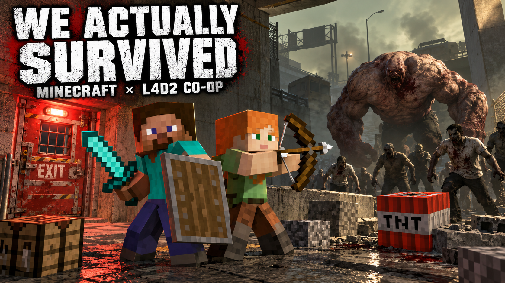
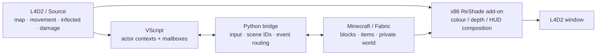

# 🧱 L4D2 × Minecraft

**Build barricades. Swing a diamond sword. Fight a Tank with your friend.**

Real Minecraft running inside a Left 4 Dead 2 session: Source owns the map, movement and infected; Minecraft supplies the blocks, inventory, items and player models. Both games stay running. A Python bridge exchanges state, and an x86 ReShade add-on combines their rendering.

[](https://github.com/Rizen1322/l4d2-minecraft/releases)
[](https://github.com/Rizen1322/l4d2-minecraft/actions/workflows/offline-checks.yml)
[](LICENSE)




*Illustration generated with OpenAI imagegen. This is promotional artwork, not a gameplay screenshot.*

**Status: playable experiment / alpha.** Solo and a two-player co-op run have been tried by the author. The latest network changes have automated coverage; a full two-PC regression run is still needed. Expect rough edges around geometry, latency and unusual camera states.

[Install](#-install) · [Co-op](#-co-op) · [Controls](#-controls) · [Architecture](#-how-it-works) · [Troubleshooting](#-when-it-breaks) · [Русская инструкция](docs/FRIEND_GUIDE_RU.md)

## 🎮 What you can do

| System | Current behavior |
|---|---|
| Building | Place and break Minecraft blocks on L4D2 maps. Nearby blocks get bounded Source collision proxies. |
| Player | Steve, Minecraft hotbar/inventory and camera switching. Walking and jumping remain L4D2's. |
| Combat | Sword cleave, tier-based Source damage, shields with stagger/cooldown, armour and health synchronization. |
| Items | TNT, flint-and-steel, food, ender pearls, chorus fruit and held totems. Support varies by item. |
| Mobs | Minecraft mobs can be spawned; golems use Source navigation queries to fight infected. |
| Supplies | L4D2 pickups become Minecraft supplies; rewards and item receipts survive retries. |
| Flight | Equipped Elytra gliding and firework boosts use native Source velocity/collisions. |
| Co-op | Shared block states, Steve teammates, separate inventories, remote mob visuals and owner-authoritative melee. |
| Map changes | A new scene isolates old blocks/entities when the Source map changes or restarts. |

Eating/drinking slows Source movement while the item is actually being used. Slow-walk also crouches Steve visually. The teammate HUD is kept above the Minecraft foreground, including the shield.

**The supported-item list is not the entire Minecraft item registry.** This is a mashup of two runtimes; anything touching both games needs an explicit integration.

## 📦 Install

### Requirements

| Component | Build target |
|---|---|
| OS / host | Windows, Steam Left 4 Dead 2, Direct3D 9, local `-insecure` session |
| Guest | Minecraft **Java 26.3**, Java **25** |
| Minecraft loader | Fabric **0.19.5**, Fabric API **0.161.0+26.3** |
| Renderer | **32-bit**, add-on-enabled ReShade **6.8.0** |
| Build tools | Python **3.12+**, Zig **0.15.2**, ReShade **6.8.0** headers, Squirrel **3.2** |
| Game tools | Official **Left 4 Dead 2 Authoring Tools**, including `vpk.exe` and `studiomdl.exe` |

Use your own copies of both games and your normal Minecraft launcher. Install the target vanilla Minecraft version once before building the mod profile.

### First setup

1. Download the **source ZIP** from [Releases](https://github.com/Rizen1322/l4d2-minecraft/releases), or clone the repository. Extract it into a permanent folder.
2. Install the tools above. [INSTALL.md](docs/INSTALL.md) has the tool links and explicit paths.
3. Close both games. Run the setup below from the project folder.
4. Refresh your Minecraft launcher's version list and launch **L4D2MC-Fabric-26.3** normally.
5. Keep Minecraft rendering, then run **Launch-L4D2MC-2K.bat**. Leave the console open until the session ends.

```powershell
python -m pip install -r requirements.txt

.\Setup-L4D2MC.ps1 `
  -Game 'D:\SteamLibrary\steamapps\common\Left 4 Dead 2' `
  -Minecraft "$env:APPDATA\.minecraft" `
  -JavaHome 'D:\ModTools\jdk-25' `
  -ReShadeDll 'D:\ModTools\ReShade32.dll' `
  -Zig 'D:\ModTools\zig\zig.exe' `
  -ReShadeInclude 'D:\ModTools\reshade-6.8.0\include' `
  -Squirrel 'D:\ModTools\squirrel\sq-win32.exe'
```

Replace those example paths with yours. `-Minecraft` points to the launcher's folder containing `versions/`, not the mod's private guest world. Custom launchers may use a different directory.

<details>
<summary><b>About Auto-Setup-L4D2MC.cmd and the download</b></summary>

The automatic helper detects local game/launcher paths and uses an existing `toolchains/` directory. It does **not** download every build tool for you. A public source ZIP does not include that directory; `Auto-Setup-L4D2MC.cmd` will report missing tools until you supply them. The explicit setup above works with tools installed anywhere.

The release contains project source, scripts, the Gradle wrapper and labelled README artwork. It contains neither game, launcher credentials, saves, private HUD portraits nor a prebuilt private-assets JAR. Setup builds portraits and HUD resources locally from your own L4D2 installation.

</details>

### Resolution and map

The 2K launcher uses **2560 × 1440, borderless windowed**. For another resolution/map:

```powershell
.\Launch-Minecraft.ps1 -Width 1920 -Height 1080 -Borderless -Map c2m1_highway
```

Steam library detection is automatic after setup. Overrides: `-Game`, `L4D2MC_GAME`, or ignored `l4d2mc.local.json`. Keep the project in the same folder after installing: the generated Minecraft profile references its location.

### Updating an existing installation

Close Minecraft, L4D2 and the old bridge console. Pull/extract the new source, then run:

```bat
Update-Coop.cmd
```

It rebuilds/tests the guest, checks the Source scripts and updates owned files. It does not launch either game or replace your co-op nickname/invitation. Both co-op PCs must update before reconnecting. If a native component changes in a later release, run the full setup/build too.

## 🤝 Co-op

Each PC runs **its own L4D2 and its own Minecraft**. One PC hosts the Source listen server and the private bridge room. There is no shared Minecraft dedicated server.

| Host | Friend |
|---|---|
| Run `Coop.bat` → **1 — host**. | Run `Coop.bat` → **2 — join**. |
| Select the LAN/VPN address and send the invitation privately. | Paste the invitation and enter **your own L4D2 name**, exactly as shown in-game. |
| Launch the Minecraft mod profile. | Launch the same mod profile/version. |
| Run the L4D2 launcher and wait for the map. | Run the L4D2 launcher after the host is in the map. |

For different networks, use a private LAN/VPN connection. The room uses **TCP 25602**; L4D2 uses the configured game port, normally **27015**. The invitation contains the private room token; do not post it with logs or commit `l4d2mc.coop.json`.

> **Nickname trap:** the joiner's name is the friend's name, not the host's. The launch console prints `Configured L4D2 player` and, on a mismatch, the host's available player names.

The code permits up to four participants. Two-player use has been tried; a four-PC session has not been verified. `Coop.bat` → **3 — off** returns the next launch to solo mode.

**Shared:** block states/deletion history, nearby collision proxies, player poses/equipment and remote entity visuals. Melee against a remote Minecraft mob goes to its owning guest server.

**Separate:** inventories, private Minecraft worlds, chest contents and block-entity NBT. Remote projectile/splash damage against Minecraft mob copies is still missing.

[Detailed co-op notes](docs/COOP.md) · [Установка другу](docs/FRIEND_GUIDE_RU.md)

## ⌨️ Controls

| Input | Action |
|---|---|
| WASD / Space | Native L4D2 movement / jump |
| Shift | Native slow-walk + Steve crouch pose |
| Space in air, with Elytra equipped | Begin gliding; use fireworks to boost |
| Left mouse | Attack / break blocks |
| Right mouse | Use / place; interact with Source doors, buttons and carried objects |
| E | Minecraft inventory |
| Escape | Source pause menu; guest UI closes first |
| 1–9 / wheel | Hotbar |
| Q / F | Drop item / swap hands |
| F5 | Camera perspective |
| T / / | Minecraft chat / command |

Keep the game window focused. Minecraft must stay rendering in the background; minimizing it can stop frame delivery. The launcher temporarily owns some bindings/addon flags and restores them when it exits normally.

## 🛠️ How it works



Source stays authoritative for the player and infected. Minecraft mobs stay authoritative in the private guest that spawned them. The bridge routes remote commands to that owner rather than applying damage to a visual copy.

### Delivery, not guesswork

```mermaid
sequenceDiagram
    participant F as Friend's Minecraft
    participant B as Friend's bridge
    participant R as Host room
    participant O as Owner's bridge
    participant M as Owner's Minecraft server
    F->>B: Hit remote mob (scene / owner / entity)
    B->>R: Event with session + sequence
    R->>R: Validate actor, entity and distance
    R->>O: Retained event + receipt
    O->>M: Dispatch to server thread
    M->>M: Validate and apply once
    M-->>O: Application ACK
    O-->>R: Completed delivery
    Note over R,M: Retry unacknowledged delivery; suppress duplicate damage
```

Queues are bounded. Unsent snapshots are replaced by newer snapshots; block edits retain state and deletion history. Discrete room actions wait for application receipts. Network membership has its own lease; a frozen Source frame still stops guest controls instead of being kept alive by fresh network traffic.

Projectiles retain their original launch point across coalesced reports. Source traces that first segment immediately, then owns impacts/teleports. Native Source geometry is queried with bounded traces; it is not converted into a full Minecraft voxel map.

## 🧪 Build and checks

The current co-op patch passed **134 Python tests**, the guest build/policy checks and **11 Source regression suites**. These check real loopback WebSockets, queues, ordering, retries, actor isolation and Source handlers. They do not measure real two-PC FPS or prove every map/item works.

```powershell
# Python transport, collision, gameplay, installer and release checks
python -m unittest discover -s passthrough -p 'test_*.py'

# Minecraft compilation + standalone Java policy checks; no game launch
.\passthrough\guest\gradlew.bat -p .\passthrough\guest build --no-daemon --max-workers=2

# Actual Windows PowerShell Start-Process argument test
powershell -NoProfile -ExecutionPolicy Bypass -File tools\test_launcher_arguments.ps1

# Full guest/native x86/Source build; uses your own game assets
.\passthrough\build.ps1

# Audit and create the public source ZIP + SHA256 + file manifest
python tools/release_source.py --check
python tools/release_source.py
```

[Development guide](docs/DEVELOPMENT.md) explains the native SDK/compiler paths. [GitHub Actions](https://github.com/Rizen1322/l4d2-minecraft/actions) runs the Python/source-release checks; full private-assets builds stay local.

## 🩹 When it breaks

| Symptom | First check |
|---|---|
| `Local Minecraft connected` | This is the Minecraft on **this PC**, not another player. |
| `Host has no fresh L4D2 player data` | Host launcher running? Host inside the map? Friend actually joined L4D2? |
| `Player not found in host L4D2 roster` | Compare `Configured L4D2 player` with the printed roster. Use the joiner's exact name. |
| Room reconnects | Same build on both PCs, host room reachable, stale bridge consoles closed. Keep the logs. |
| Missing bundled tools | A source ZIP has no `toolchains/`. Supply the pinned tools and use explicit setup paths. |
| Old Minecraft profile conflict | Setup preserves the conflicting profile JSON beside it before installing the new one. Personal worlds stay separate. |
| Blocks leak through walls / camera drift | Restart both games after updates; report the map, viewpoint and renderer logs. Depth remains approximate. |
| Locked component during update | Close both games and rerun the updater. |

Useful files:

- `setup-log.txt` — automatic setup transcript.
- `evidence/bridge-runtime.log` and `evidence/bridge-errors.log` — **from both PCs** for co-op failures.
- `left4dead2/console.log` — Source/VScript errors, inside the L4D2 installation.
- `dist/source-check.log` / `dist/native-build.log` — compiler diagnostics.
- Minecraft `logs/latest.log` / `crash-reports/` — inside the private guest directory.

Do not include the room config/token or launcher credentials in a bug report. [Troubleshooting and uninstall](docs/TROUBLESHOOTING.md) · [Report a bug](https://github.com/Rizen1322/l4d2-minecraft/issues/new/choose)

## 🚧 What is still rough

- Vehicle edges, slopes, thin surfaces and unusual/custom map geometry can defeat the bounded collision traces.
- Golem navigation and movement are not correct around every obstacle.
- Co-op shares block states, not a complete Minecraft server/world. Remote projectile and splash combat need more work.
- Depth/reprojection can fail with unusual cameras, effects or unsupported antialiasing.
- Totem/armour rescue depends on available Source hooks; a wipe or Director restart can interrupt it.
- Other Workshop/ReShade mods and protected/public sessions are unvalidated. The launcher uses a private `-insecure` session.

[Known issues](docs/KNOWN_ISSUES.md) records the remaining gaps. Please include reproduction steps rather than only “it lagged”.

## 📁 Where things live

```text
passthrough/
  bridge.py, coop.py     local bridge + private LAN room
  combat.py             bounded guest → Source gameplay mailbox
  host/                 Source VScript gameplay/navigation/survival
  guest/src/            Fabric client + integrated-server code
  native/               x86 rendering, camera and input hooks
  shaders/              composition and teammate HUD
  test_*                offline regression suites
tools/                  assets, co-op setup/update and release packaging
docs/                   installation, architecture notes and limitations
```

The earlier cube sandbox remains in `addon/` and `assets-src/` as history. The active mashup uses its procedural cube for Source collision; public releases build it from source.

## 🙌 Credits and license

Project direction and gameplay testing: **Rizen1322**. Based on MIT passthrough work by **Rehan / universal-modder contributors**; original notices are retained. Inspired by [Portalcraft](https://github.com/Griffdog21/Portalcraft).

Code, debugging, tests and documentation were developed with **OpenAI Codex and collaborating agents**. README artwork uses OpenAI imagegen. [CREDITS.md](CREDITS.md) lists the libraries, attribution and AI disclosure.

Project code is [MIT](LICENSE). Minecraft, Left 4 Dead 2 and privately extracted HUD resources belong to their respective owners and are not covered by that license. Do not upload the locally built portrait-bearing JAR or HUD VPK.

[Changelog](CHANGELOG.md) · [Releases](https://github.com/Rizen1322/l4d2-minecraft/releases) · [Issues](https://github.com/Rizen1322/l4d2-minecraft/issues)
