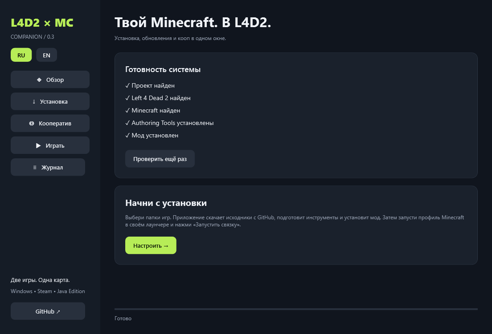

# L4D2MC Companion

Small Windows WPF app for the mashup. Built with .NET Framework 4.8; the distributed EXE needs no .NET SDK. Windows 10/11 with .NET Framework 4.8 is the supported desktop environment.

Use **RU / EN** in the sidebar to change the language instantly. The selection is saved for the next launch. Labels, app status and app-generated errors are translated; logs emitted by external tools remain in their original language.



## What the buttons do

- **Установка**: detects Steam libraries and Legacy/standard Minecraft directories, downloads a GitHub source release, verifies its SHA-256 and file manifest, prepares private toolchains, runs the existing game installer.
- **Кооператив**: creates an invitation for your LAN/VPN address or joins an invitation using **your own** L4D2 name. Tokens stay in the existing local co-op config; they are never sent as process arguments.
- **Играть**: opens the Minecraft folder/Legacy Launcher, then starts the existing Source/bridge launcher with a selected borderless resolution. Minecraft still starts through your normal signed-in launcher.
- **Журнал**: streamed build and startup output. The log is `%LOCALAPPDATA%\L4D2MC\companion.log`.

Install/update with both games closed. The source update preserves private game data, backups and room settings, but replaces project source files. Developers should use a separate checkout if they have local code changes. Authoring Tools are installed through Steam, using the app's dedicated button.

The app downloads Python 3.12.10, Java 25, Zig 0.15.2, ReShade 6.8.0 and Squirrel 3.2 from their upstream distribution sites. Tools stay under `project/toolchains`. Embedded Python uses a local setuptools/wheel environment because pip's isolated source-build environment does not work with its `_pth` configuration. No game assets, Minecraft login credentials or game-derived HUD resources ship in this executable.

Co-op still needs a shared LAN/VPN network and reachable TCP 25602 / L4D2 server. The app does not configure a VPN or router. It remains open while its launcher runs; close L4D2 to stop the bridge and restore launcher-owned settings.

## Build / verify

```powershell
dotnet build companion/L4D2MC.Companion.csproj -c Release
dotnet build companion/tests/Companion.Tests.csproj -c Release
./companion/tests/bin/Release/net48/Companion.Tests.exe
```

Tests run an actual child process to verify Unicode paths, spaces, embedded quotes and trailing backslashes. They also check archive traversal rejection, invitation role/nickname and stable host tokens. Opt-in `--download <empty-folder>` and `--tools <folder>` checks exercise real downloads without starting or modifying a game. The app supports `--preview <png-path>` for a rendered UI snapshot.

Release packaging includes only the application EXE, its SHA-256, and the source archive. Toolchains are downloaded by each user. The EXE is unsigned; release checksums verify the downloaded bytes, they do not replace a publisher certificate.
